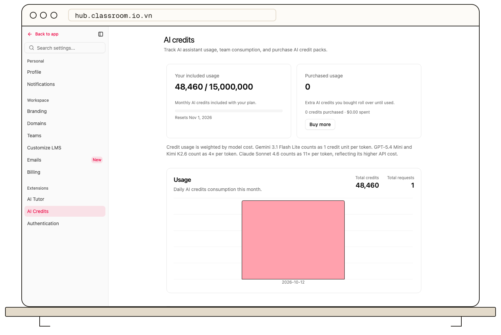

Open **Settings → AI Credits** in the active organization to review AI usage. The page shows usage summary cards and a chart.

AI course and content features consume credits according to the action shown in the product. Review the cost note on this page before a large generation task. The usage display helps you identify consumption over time; it is separate from the account's organization and student limits.

If an AI action reports insufficient credits, check this page and the current organization, then [contact ClassroomHub support](mailto:support@classroom.io.vn) to add credits.

## Related guides

- [Understand student and organization limits](/account-team-security/understand-student-and-organization-limits)
