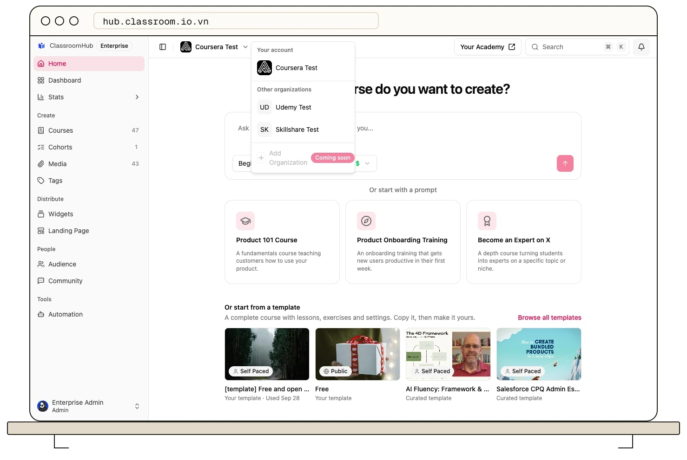

A ClassroomHub account can include one or more organizations.

:::info[Current organization-management availability]
The organization switcher can switch between organizations you already belong to, but the current Settings navigation does not expose the screen for creating or deleting additional organizations. **Add Organization** in the switcher is also marked **Coming soon**. Contact [ClassroomHub support](mailto:support@classroom.io.vn) if you need to add or remove an organization from an Enterprise account.
:::

## Primary and additional organizations

The first organization in the account is the **primary organization**. Every organization linked to the same account after that is an **additional organization**.

| Behavior                      | Primary organization                            | Additional organization                         |
| ----------------------------- | ----------------------------------------------- | ----------------------------------------------- |
| Deletion                      | Cannot be deleted as an additional organization | Can be permanently deleted                      |
| Courses, people, and settings | Separate from every other organization          | Separate from every other organization          |
| Academy address               | Has its own site name or verified custom domain | Has its own site name or verified custom domain |

The account can summarize usage across its organizations, but content and membership are not copied between them. Adding a course, student, tutor, domain, or brand setting to one organization does not add it to another.

## Switch between organizations

### 1. Open the organization switcher

In the admin dashboard sidebar, select the current organization name and avatar.

### 2. Choose an organization

Select the organization you want to manage. ClassroomHub reloads the admin dashboard with that organization's theme, courses, people, and settings.

Organizations covered by the current account appear under **Your account**. Separate organization memberships appear under **Other organizations**.

### 3. Confirm the active organization

Check the organization name in the sidebar before creating content, changing settings, or inviting people. Changes apply only to the active organization.

## Before removing an organization

:::danger[Organization deletion is permanent]
Deleting an additional organization permanently removes that organization, its members, and its courses. It cannot be undone. The primary organization cannot be deleted through additional-organization management.
:::

Before requesting removal, confirm the organization name and academy site name, export any records you must retain, and tell affected administrators and students. Deleting one organization does not delete the primary organization or its other additional organizations.

## Related guides

- [What is ClassroomHub?](/get-started/what-is-classroomhub) — understand organizations, academies, courses, and the LMS
- [Roles and permissions](/organization-and-team/roles-and-permissions) — decide who should administer each organization
