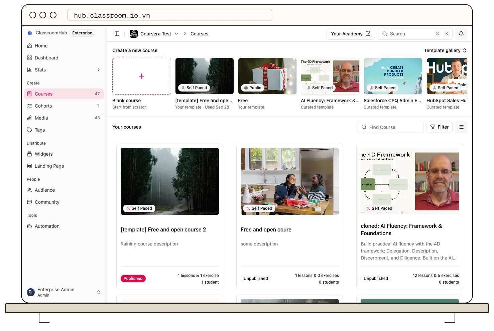

This guide will teach you everything you need to build and run your academy: creating courses and exercises, running live
classes, enrolling students, publishing your landing pages, and managing your organization and
team. Looking for the student-facing view instead? See [Student Guides](/student-onboarding/join-a-course).

## Just getting started?

<Card title="Create your Account" href="/get-started/signup" icon="rocket" cta="Start here" type="tip" horizontal>
  Build a course end to end, from lessons to publishing, in one walkthrough.
</Card>

## Browse by topic

<CardGroup cols={2}>
  <Card title="Create & deliver learning" href="/create-and-deliver/course-types" icon="graduation-cap">
    Course types, exercises, grading, progression rules, certificates, and live classes.
  </Card>
  <Card title="Manage students & enrollment" href="/manage-students/course-enrollment" icon="users">
    How students join a course, invites, cohorts, and your audience.
  </Card>
  <Card title="Publish & brand your academy" href="/publish-and-brand/course-landingpage" icon="globe">
    Landing pages, sharing your academy, and custom domains.
  </Card>
  <Card title="Organization & team" href="/organization-and-team/admin-dashboard" icon="building-2">
    The admin dashboard, roles, permissions, and tags.
  </Card>
  <Card title="Integrations & SSO" href="/integrations/enterprise-sso-setup" icon="plug">
    Connect an identity provider and find the API and developer docs.
  </Card>
  <Card title="Student guides" href="/student-onboarding/join-a-course" icon="user">
    The student-facing view: joining courses, live classes, and Community.
  </Card>
  <Card title="Reference" href="/reference/glossary" icon="book-a">
    Glossary and concept overviews — what a course, cohort, or organization actually is.
  </Card>
</CardGroup>

## Contact us

<CardGroup cols={3}>
  <Card title="Facebook" href="https://facebook.com/ClassroomHub.io.vn" icon="facebook">
    Announcements, releases, and what we are shipping next.
  </Card>
  <Card title="Telegram" href="https://t.me/ClassroomHub" icon="send">
    Message @ClassroomHub — the fastest way to reach a person.
  </Card>
  <Card title="Email" href="mailto:support@classroom.io.vn" icon="mail">
    support@classroom.io.vn, for anything that needs a written trail.
  </Card>
</CardGroup>
