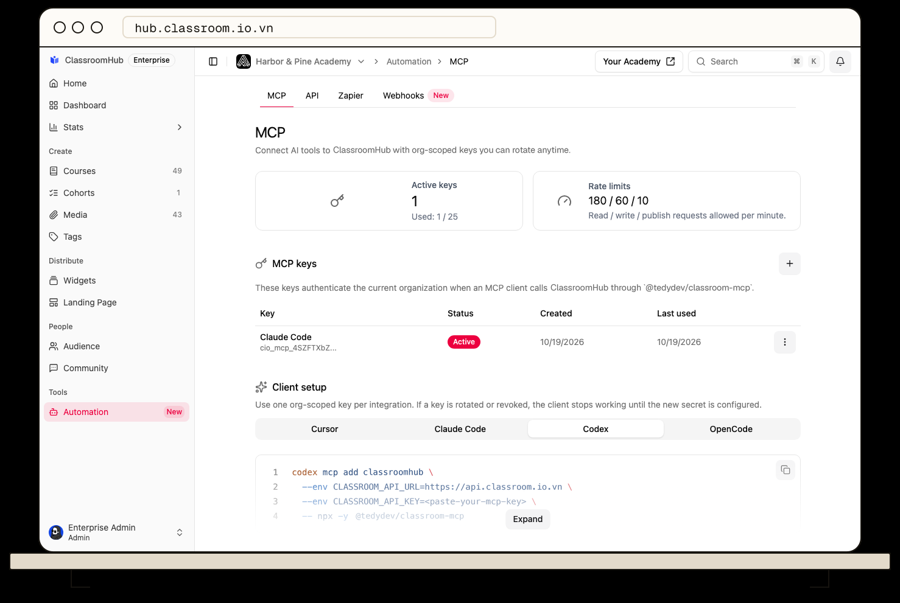

First [create an MCP key](/integrations-and-automation/create-rotate-and-revoke-mcp-keys) in **Automation → MCP**. Install Node.js so your client can run `npx -y @tedydev/classroom-mcp`. The server needs `CLASSROOM_API_URL=https://api.classroom.io.vn` and your key in `CLASSROOM_API_KEY`.



The **Automation → MCP** page also has client-specific setup snippets. Store the key in your secret manager and make it available as `CLASSROOM_API_KEY` to the client process before starting the client. The examples below refer to that variable, so the key does not appear in terminal commands or configuration files. Never commit a live key.

## Claude Code

Add this entry to a private or project `.mcp.json` file. Claude Code expands the variable when it starts the server.

```json
{
  "mcpServers": {
    "classroomhub": {
      "command": "npx",
      "args": ["-y", "@tedydev/classroom-mcp"],
      "env": {
        "CLASSROOM_API_URL": "https://api.classroom.io.vn",
        "CLASSROOM_API_KEY": "${CLASSROOM_API_KEY}"
      }
    }
  }
}
```

## Codex

Add this entry to `~/.codex/config.toml`. `env_vars` forwards the named variable from the environment instead of storing its value.

```toml
[mcp_servers.classroomhub]
command = "npx"
args = ["-y", "@tedydev/classroom-mcp"]
env_vars = ["CLASSROOM_API_KEY"]

[mcp_servers.classroomhub.env]
CLASSROOM_API_URL = "https://api.classroom.io.vn"
```

## Cursor and OpenCode

For Cursor, add a `classroomhub` entry to your personal `~/.cursor/mcp.json`. The variable reference reads the key from Cursor's environment when it starts.

```json
{
  "mcpServers": {
    "classroomhub": {
      "command": "npx",
      "args": ["-y", "@tedydev/classroom-mcp"],
      "env": {
        "CLASSROOM_API_URL": "https://api.classroom.io.vn",
        "CLASSROOM_API_KEY": "${env:CLASSROOM_API_KEY}"
      }
    }
  }
}
```

For OpenCode, add a local server to your OpenCode config: `opencode.json` in your project root, or `~/.config/opencode/opencode.json` to make the server available in every project. The `{env:...}` reference reads the key from OpenCode's environment.

```json
{
  "$schema": "https://opencode.ai/config.json",
  "mcp": {
    "servers": {
      "classroomhub": {
        "type": "local",
        "command": ["npx", "-y", "@tedydev/classroom-mcp"],
        "environment": {
          "CLASSROOM_API_URL": "https://api.classroom.io.vn",
          "CLASSROOM_API_KEY": "{env:CLASSROOM_API_KEY}"
        }
      }
    }
  }
}
```

Use the configuration file or UI specified by your client. The locations and schemas can change with client releases; check the [Claude Code](https://code.claude.com/docs/en/mcp), [Codex](https://developers.openai.com/codex/config-reference), [Cursor](https://docs.cursor.com/context/model-context-protocol), or [OpenCode](https://opencode.ai/v2/docs/mcp-servers) documentation if your client uses a different format.

Restart or reconnect the client and check that ClassroomHub is connected. Try asking it to list courses in the intended organization before allowing changes. If the connection fails, check that Node.js can run the package and the JSON or command is valid. If a request is unauthorized, check the API URL, key status, and the key creator's permissions. See MCP access and limits.
