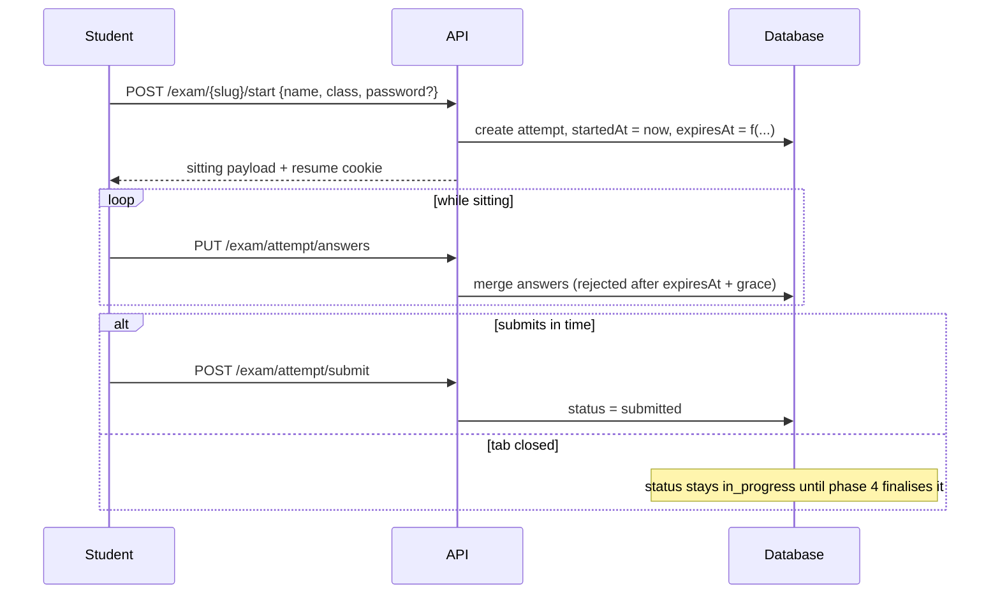

# Phase 3: Attempt lifecycle and the server clock

## Overview

Three endpoints — start, save, submit — and the arithmetic that decides when an attempt
dies. The browser is never trusted with the clock, and the browser is never the only place
an answer has been.

## Requirements

Functional:

- Starting an attempt returns the sitting payload and sets a resume cookie.
- Reopening the exam with a live attempt resumes it, with the time already spent gone.
- Saving answers is idempotent and accepted repeatedly during the attempt.
- Submitting finalises the attempt.
- Anything arriving after expiry plus grace is refused.

Non-functional:

- The expiry arithmetic is a pure function, tested without a database or a real clock.
- The resume cookie is `httpOnly`, `Secure` and `SameSite=None`, and survives a cross-origin
  request. See below — `Lax` would fail in production only.

## Architecture

The rule Azota states is that exam time equals the moment the student opens the paper plus
the working time. Combined with the availability window:

```
expiresAt =
  workingSeconds === null && closesAt === null  -> null            (never expires)
  workingSeconds === null                       -> closesAt
  closesAt === null                             -> startedAt + workingSeconds
  otherwise                                     -> min(startedAt + workingSeconds, closesAt)
```

A student entering ten minutes before the window closes gets ten minutes, not the full
duration. This falls out of the `min`, which is why the rule is expressed as arithmetic
rather than as branches in a handler.

Writes are accepted until `expiresAt + GRACE`, where grace is thirty seconds. The grace
exists because a final save on a phone network can legitimately be in flight when the
clock strikes; it is not a courtesy extension, and it is not exposed in the countdown.



Resume is by cookie, not by name. Two students typing the same name get separate attempts;
the same student refreshing gets the same one. The cookie is the only thing that makes a
refresh continue rather than restart, and it cannot survive a private window — which is a
limitation of identity-by-name, not a bug to fix here.

**The resume cookie must be `SameSite=None`, and this is not a preference.** In production the
dashboard and the API are different hosts — `msna.classroom.io.vn` and `api.classroom.io.vn`
— and the API client already sets `credentials: 'include'` for exactly that reason
(`apps/dashboard/src/lib/utils/services/api/index.ts:267`). A `Lax` cookie is withheld on
cross-site subresource requests, so every autosave and every submit would reach the server
with no cookie: no resume, no saved work, on exam day.

This project has met this bug before and left the evidence in the file phase 3 otherwise
copies for its cookie handling. `apps/api/src/routes/org-site/public-course.ts:78` sets the
HLS cookie to `None` with the comment: "Lax is withheld on cross-site subresource requests,
which would 403 every segment when the public site and api/stream live on different hosts."

It would also have passed every test in this plan. Development runs on one host; an
integration test calls the API directly with its own cookie jar. The failure appears only in
production, only under a real browser, only when a class is sitting the paper. So the test is
specified explicitly: assert the cookie is attached on a cross-origin request, not merely
that it was set.

`SameSite=None` on an unauthenticated write endpoint invites cross-site request forgery — a
hostile page could make a visitor's browser submit their paper. The endpoints therefore
require a custom request header, which a cross-site `fetch` cannot send unless our CORS policy
allows that origin, and check `Origin` against the allow-list.

**`maxAttempts` is an honest limit, not an enforced one.** In public mode it is counted per
cookie, so a private window defeats it, exactly as a fresh clock does. It is worth having
because most students will not try, and it must not be described anywhere as preventing a
second attempt.

**Input validation belongs here, not in phase 7.** These endpoints are the trust boundary,
and validating what an anonymous caller may write is part of their contract rather than a
hardening pass to be added later. Every write therefore checks, before it touches the
database: the declared fields are present when the exam asks for them, are non-blank, and
are within length bounds; the answer payload is within a size bound; and every answered
question belongs to the pinned paper.

That last check is not cosmetic. Phase 4 normalises answers with
`prepareSubmissionAnswers`, which raises an error for an answer referencing a question
outside the paper. If such an answer can be stored here, it becomes a permanently
unscoreable attempt that fails every later read — so the shape of what is stored is
constrained at the only point where rejecting it is still cheap.

**The server assigns the revision.** Each stored answer records the `questionRevisionId`
taken from the exam's pinned snapshot, never from the request. A client that supplies its
own revision picks which answer key it is marked against, which is worth doing precisely
when a teacher has corrected a wrong key mid-exam.

**What is recorded is only what the server sees.** Starting an attempt stores the request's
`User-Agent` header — the header itself, never client-side fingerprinting — alongside the
salted `ipHash`. Both are byproducts of requests a student must make in order to sit the
paper at all, which is what makes them worth keeping: they cannot be suppressed without
forfeiting the attempt.

That test is the line this plan draws around observation. A tab-switch beacon fails it,
because it is reported by the very person it watches and can be silenced for free. Data like
that is untrustworthy at the moment of capture, not merely unsurfaced, which is why none is
collected here.

**Every change is kept, not just the last one.** Each save appends to `answerLog` as well as
updating `answers`. Azota records "thời điểm học sinh chọn đáp án, thay đổi đáp án, đáp án
ban đầu và đáp án cuối cùng" and uses it to settle disputes about a result and, alongside
the screen-exit log, to spot something odd.

For us this costs almost nothing: autosave already sends every change to the server, and we
were about to discard all but the latest. Keeping them is a decision not to throw away data
already in hand. `answers` stays the current state, because that is what grading reads;
`answerLog` is append-only and never read by the grader.

**Saves are serialised per attempt.** Merging answers by reading the row, combining in
application code, and writing it back loses an update whenever two saves overlap — and
phase 5's design creates overlapping saves by pairing a debounced save with an interval
save and a retry. The merge therefore happens either under `SELECT … FOR UPDATE` inside the
transaction, or in a single SQL statement operating on the jsonb. The guarded update in
phase 4 protects finalisation only; it does nothing for this.

## Related code files

- Create: `apps/api/src/services/exam/exam-attempt-clock.ts`
- Create: `apps/api/src/services/exam/exam-attempt-clock.test.ts`
- Create: `apps/api/src/services/exam/exam-attempt.ts`
- Create: `apps/api/src/services/exam/exam-attempt.integration.test.ts`
- Modify: `apps/api/src/routes/exam/exam.ts` — add the three sitting endpoints
- Reference: `apps/api/src/routes/org-site/public-course.ts` for the existing
  `setCookie` usage from `hono/cookie`

## Implementation steps

1. **Write the clock test first**, as a table with one row per branch of the formula
   above, plus the two boundaries: a write exactly at `expiresAt` is accepted, and a write
   at `expiresAt + grace + 1s` is refused. Inject the current time as an argument; never
   read the clock inside the function under test.
2. Implement `exam-attempt-clock.ts` against it.
3. **Write the resume integration test**: start an attempt, advance the stored `startedAt`
   into the past, reopen with the same cookie, and assert the remaining time has shrunk
   rather than reset, and that no second attempt row was created.
4. Implement start, including the password check, the attempt cap, and the window check —
   an exam that has not opened or has closed refuses to start.
5. **Write the concurrent-save test**: two saves for different questions issued together
   both survive. Then implement save — merging by question rather than replacing the
   array, under a row lock or in one SQL statement.
6. **Write the validation tests**: an over-long name; a name of only whitespace; a missing
   field the exam requires; an oversized answer payload; an answer referencing a question
   outside the paper. Each is refused before anything is written. Then implement them.
7. Implement submit, rejecting a second submit on an already-finished attempt.

## Success criteria

- [x] Every branch of the expiry formula has a test, including both boundary cases
- [x] Reopening with a live cookie resumes the attempt and creates no second row
- [x] A save after `expiresAt + grace` is refused with a distinguishable error, not a
      generic failure
- [x] A save carrying one answer does not erase previously saved answers
- [x] Two overlapping saves for different questions both survive
- [x] An answer referencing a question outside the pinned paper is refused at save time
- [x] Every sitter-supplied field is length-bounded and rejected when blank
- [x] The stored revision comes from the pinned snapshot, and a client-supplied revision is
      ignored
- [x] Starting an exam outside its window is refused
- [x] Starting past `maxAttempts` is refused for a sitter who keeps their cookie
- [x] The resume cookie is `httpOnly`, `Secure`, `SameSite=None`, and scoped per exam
- [x] The cookie is attached to a request from a different origin — asserted against the
      cross-origin case, not merely against the cookie being set
- [x] A write without the required custom header, or from an origin outside the allow-list,
      is refused

## Risk assessment

**Clock read inside the function.** The commonest way this logic becomes untestable is
calling `Date.now()` inside it. Injecting the instant is not ceremony; it is the only way
the boundary cases can be asserted at all.

**Answer merge versus replace.** Replacing the array is the obvious implementation and it
silently destroys work whenever a save request carries a partial payload — which is
exactly what an autosave does. The test for this exists because the bug is easy and its
symptom is invisible until a student complains their answers vanished.

**Timezones.** All stored instants are `timestamptz`. Any comparison done in local time
will be correct in Vietnam and wrong wherever the server moves. Compare in UTC.

**Grace as an exploit.** Thirty seconds is short enough to be worthless as extra time and
long enough for a slow request. Do not make it configurable; a configurable grace becomes
a negotiated grace.
