# Public timed exam

## Overview

A teacher publishes an exam as a link and sends it to a class. A student opens it,
declares their name, sits the paper against a clock the server owns, and their answers
reach the server whether or not their browser survives to the end. The teacher sees who
sat it, how far they got, and what they scored.

The same exam entity also serves signed-in students, so a private exam and a public one
differ only in how the sitter is identified.

Exercises are untouched. They keep requiring an account and keep recording progress
exactly as they do today, and no code on that path learns that exams exist.

Design rationale, the Azota comparison, and the rejected alternatives live in
`plans/reports/brainstorm-260812-0843-public-timed-exam-workflow.md`. This plan does not
repeat that argument; it implements its conclusion.

## Goals

| # | Goal | Priority |
|---|------|----------|
| 1 | A student without an account can sit a timed exam from a link and have it recorded | P1 |
| 2 | The clock is server-authoritative; a refresh, a devtools session, or a changed device clock buys no time | P1 |
| 3 | No answer key reaches the browser of a student being scored | P1 |
| 4 | A closed tab or dead battery does not lose the work already done | P1 |
| 5 | Exercises, submissions, the gradebook, progress and certificates are unchanged | P1 |
| 6 | The teacher can read results and delete them | P2 |
| 7 | The public write endpoints resist casual abuse | P2 |

## Non-goals

Per-student one-time links, class rosters, a live teacher-hosted room, camera or
screen-recording proctoring, question and option shuffling, sub-papers and random selection
by blueprint, a question bank, practice mode, Excel and Word export, per-question
statistics, AI-assisted marking, and any bridge between exam results and the course
gradebook. Each is a later decision, not a forgotten one; several are features Azota has
and we deliberately postpone.

The homework side of Azota — `Bài tập`, where a student uploads a photograph or a file of
written work for a teacher to annotate — is a different product surface entirely and is not
in scope here.

**Oversight is a later plan, not a later phase.** Screen-exit monitoring, statistics,
duplicate-pattern analysis and richer per-student process views all read data this plan
already writes. None of them stops a class sitting an exam, and designing their screens now
would mean designing against imagined data. They belong in a separate plan, written once real
attempts exist — deliberately not scaffolded here, because a stub plan directory is the split
we considered and rejected, arriving by the back door.

Screen-exit monitoring stays out for reasons worth recording, so it is not relitigated. Azota
sells proctoring and still warns that on web browsers "hệ thống có thể không ghi nhận đầy đủ
số lần chuyển tab" — an incomplete count invites a teacher to read meaning into a number that
does not carry it. Most of its value is deterrent rather than evidential, which is a product
decision rather than an engineering one. And the answer trail already gives a partial signal
from data the server observes directly: a paper answered entirely in its final two minutes is
visible without any client cooperation.

Nothing here forecloses adding it later; the attempt row is where it would go.

## Architecture

```mermaid
flowchart LR
  subgraph Content["Content — shared, unchanged"]
    EX[exercise<br/>question container]
    Q[question]
    QR[questionRevision]
    EX --> Q --> QR
  end

  subgraph Delivery["Delivery — new, isolated"]
    E[exam]
    A[exam_attempt]
    E --> A
  end

  subgraph Existing["Existing — never touched"]
    S[submission]
    QA[questionAnswer]
    GM[groupmember]
    S --> QA
    GM --> S
  end

  E -.points at.-> EX
  A -.pins.-> QR
  IMP[.docx import] --> EX
```

An exam owns an `exercise` row used purely as a question container, with **both**
`courseId` and `lessonId` null.

Both matter. An earlier draft of this plan claimed a container was invisible because
listings filter by lesson. That is true of `getExercisesByLessonIds` and false of the
listing actually used: `getExercisesByCourseId`
(`packages/db/src/queries/exercise/exercise.ts:121`) matches
`or(exercise.courseId, lesson.courseId)`, the gradebook query joins the course the same way
and applies no visibility filter, and the learner listing
(`packages/db/src/queries/exercise/lms.ts:75`) matches `exercise.courseId`. A container with
a course but no lesson would have appeared in all three — including, with the default
`ALL_STUDENTS` assignment mode, as an ordinary exercise any enrolled student could open and
answer before the exam opened, with no clock at all.

Nulling the course keeps it out of all three. The container is additionally created with
`assignmentMode = 'SELECTED_STUDENTS'` and no assignees, as a second line of defence rather
than the fix.

The paper is frozen onto the exam at publish time, so grading never depends on the live
question rows surviving a later edit.

Exam answers are stored on the attempt rather than in `questionAnswer`, so no nullable
foreign key is added to a central table. Each stored answer still records the
`questionRevisionId` it was given against, preserving the invariant the assessment model
is built on: an answer is meaningless without the exact revision it answered.

## Phases

| # | Phase | Status |
|---|-------|--------|
| 1 | [Data model and migration](./phase-01-data-model-and-migration.md) | Pending |
| 2 | [Exam settings and sanitised delivery](./phase-02-exam-settings-and-sanitised-delivery.md) | Pending |
| 3 | [Attempt lifecycle and the server clock](./phase-03-attempt-lifecycle-and-the-server-clock.md) | Pending |
| 4 | [Grading and finalisation](./phase-04-grading-and-finalisation.md) | Pending |
| 5 | [Sitting the exam](./phase-05-sitting-the-exam.md) | Pending |
| 6 | [Reading the results](./phase-06-reading-the-results.md) | Pending |
| 7 | [Abuse limits and personal data](./phase-07-abuse-limits-and-personal-data.md) | Pending |
| 8 | [Teacher exam management](./phase-08-teacher-exam-management.md) | Pending |

**Execution order: 1, 2, 8, 3, 4, 5, 6, 7.** Phase 8 is numbered last because it was added
after the red-team pass, which found the plan described an API a teacher had no way to
reach; it runs third.

Phases 1, 2, 3 and 4 are strictly ordered. Phase 5 needs 3. Phase 6 needs 4. Phase 7 may run
alongside 5 and 6, and turning on its environment flag is the act that releases the feature.

One ordering rule is not negotiable: **the sanitised payload of phase 2 ships before the
clock of phase 3**. A timed paper that leaks its answer key is theatre.

## Test strategy

Every phase is written tests-first. The repository runs Vitest (`pnpm --filter @cio/api
test`), with sixty unit tests and four integration tests that reach a real database; the
integration convention is a `*.integration.test.ts` suffix.

Pure logic — expiry arithmetic, payload sanitising, grading — is unit tested with no
database. Anything touching persistence, constraints, or the finalisation path gets an
integration test, because those are the failures that only appear against real Postgres.

Database-backed tests live in `apps/api` as `*-db.integration.test.ts`, following
`exam-import-db.integration.test.ts`. They cannot live in `packages/db`, which has no Vitest
configuration and no test files at all.

Three regression guards run in every phase from 2 onward:

- The existing public-course payload still contains `isCorrect`, and
  `apps/api/src/services/course/public-course.test.ts` still passes untouched. This is the
  guard that we did not break client-side grading for existing public courses.
- No new column appears on `exercise`, `submission`, `questionAnswer` or `groupmember`.
- A question container appears in none of the course exercise list, the learner exercise
  list, or the gradebook, proven against a real database with a real enrolled student.

## Success criteria

- [ ] A student refreshing mid-exam keeps their remaining time and their saved answers
- [ ] A student who closes the tab at the last minute still has a score the teacher can see
- [ ] Devtools on the exam page reveals no answer key
- [ ] A submission arriving after expiry plus grace is rejected
- [ ] An expired attempt that was never submitted is finalised on first read
- [ ] Every stored exam answer records the question revision it was given against, assigned
      by the server from the frozen paper
- [ ] An enrolled student never sees a question container anywhere in the course
- [ ] One unscoreable attempt does not stop the rest of the class's results rendering
- [ ] The existing public-course test suite passes unmodified
- [ ] `git diff` shows no change to the exercise, submission, gradebook or certificate paths

## Decisions taken

**Hand-marked questions are supported, following Azota.** A paper may mix questions the
server scores with questions a teacher reads. The auto-scoreable part is scored on
submission, the attempt sits at `awaiting_manual`, and the teacher marks the rest inside the
per-attempt detail view — a score box and a comment box per question, one save, exactly
where Azota puts it under a tab labelled `Tự luận` with a `Lưu điểm` button. Azota's
AI-assisted marking is not copied. Until a paper is marked, its score is always presented
with what it covers, never as a bare number.

**An exam always belongs to a course.** Authorisation follows course team membership and
the entry point is a tab inside the course. `exam.courseId` stays nullable so a standalone
exam is possible later without a migration, but nothing in this release creates one.

**The paper password ships in the first release.** One nullable column and one check at
start. It does not stop a determined cheat, but it is the only cheap answer to the risk
that actually occurs: a link shared in a class group chat and forwarded outside it.

## Open questions

None outstanding.
